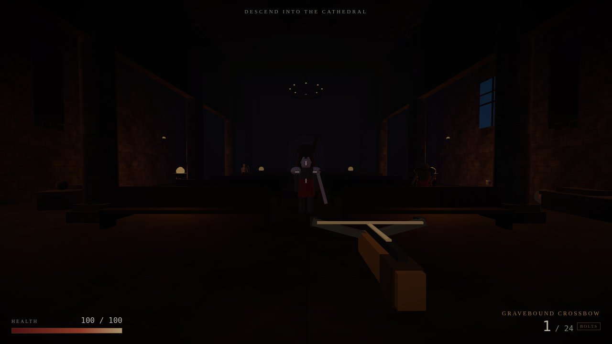
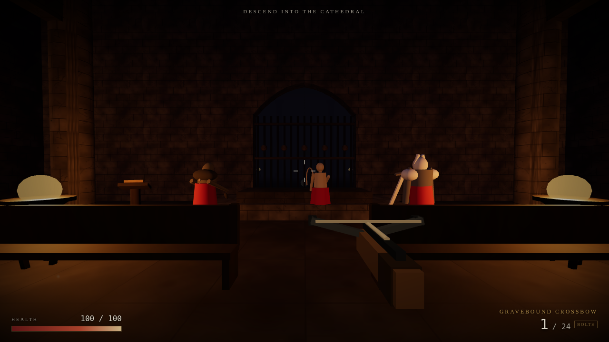
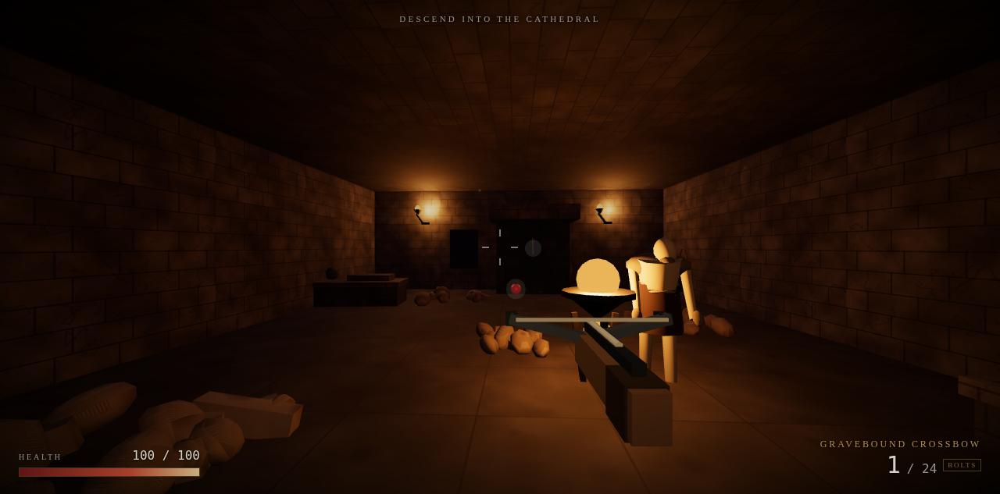
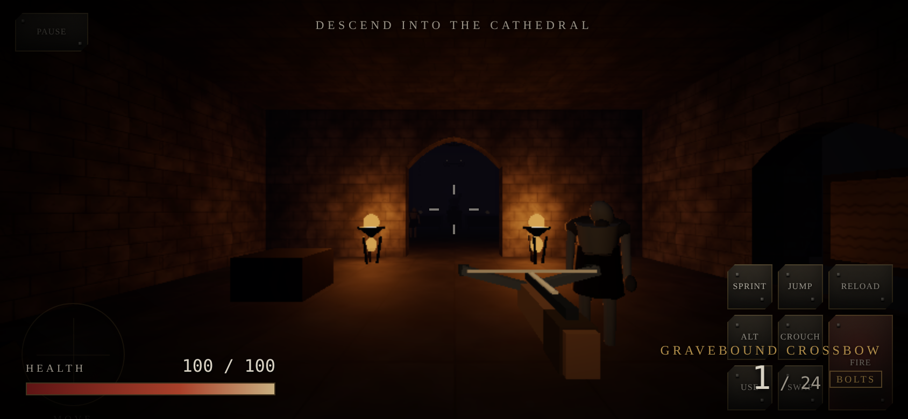

# The Hollow Cathedral

A dark fantasy first-person shooter that runs in a web browser. Built with
Three.js and Vite, deployed to GitHub Pages, playable on desktop and mobile.

> *Beneath the nave the bells still toll for no one. Go down. Bring the light
> back, or feed the dark.*



| | |
|---|---|
|  |  |
| Three kinds of undead | Bones, candles and a locked door |

---

## Play it

**Live:** https://scottpendlebury.github.io/hollow-cathedral/

**Repository:** https://github.com/scottpendlebury/hollow-cathedral

The game is static: no backend, no database, no account, no API key. Open the
URL and it runs.

---

## The game

You descend into a drowned cathedral to find the bone key that seals the
sanctum, and whatever is still walking inside it.

### Weapons

Three weapons with deliberately different economies. Switching is instant
(number keys, mouse wheel, or the on-screen swap button).

| Weapon | Damage | Ammunition | Behaviour |
|---|---|---|---|
| **Gravebound Crossbow** | 58 | Bolts (1 loaded) | Accurate, hitscan, but a 2.1s reload between shots. The workhorse. |
| **Occult Hand Cannon** | 145 | Black powder (1 loaded) | Devastating and slow to reload (3.0s). Powder is scarce — miss and you pay for it. |
| **Soulwick** | 24–46 | Soul essence (8) | Hold to charge for up to 0.75s, then release. Scales from a trickle to a heavy drain. |

### Enemies

Three archetypes plus a boss, each with its own state machine, sight range
and attack pattern. They patrol, notice you, pursue, telegraph attacks, and
respect their cooldowns.

- **Husk** — a stooped, emaciated corpse. Slow, relentless, swarms. 55 HP.
- **Archer** — a skeletal frame with a long bone bow. Keeps its distance,
  fires bone bolts, strafes to stay awkward to hit. 42 HP.
- **Knight** — an armoured revenant with a great sword. Slow, heavy, and it
  hits for 32. 150 HP.
- **The Choir Warden** — a scaled-up knight guarding the dais. 480 HP.

### The level

One hand-authored level, *The Hollow Cathedral*, in four connected areas:

1. **The Threshold** — the entry hall, where the descent begins.
2. **The Nave** — the main hall: a colonnade, pews, high stained-glass
   windows, and the landmark of the level, the Broken Saint at the crossing.
3. **The Ossuary** — an optional side passage off the nave's west wall, full
   of bone piles. The Bone Key is here.
4. **The Apse** — the sanctum, lit by sickly green braziers, guarded by the
   Choir Warden on the dais.

Progression: find the Bone Key in the Ossuary → unlock the Sanctum Gate →
defeat the Choir Warden → the exit seal opens → reach the exit to win.

### Screens

Title, pause, settings, death and victory screens. Settings and best
completion time persist in `localStorage`.

---

## Controls

### Desktop

| Input | Action |
|---|---|
| `W` `A` `S` `D` | Move |
| Mouse | Look |
| Left click | Fire (hold to charge the Soulwick) |
| Right click | Brace / alt fire |
| `Shift` | Sprint (drains stamina) |
| `Space` | Jump |
| `Ctrl` / `C` | Crouch |
| `R` | Reload |
| `E` / `F` | Interact |
| `1` `2` `3` / wheel | Switch weapon |
| `Esc` | Pause (releases pointer lock) |

Click the canvas to capture the mouse. If pointer lock is unavailable the
game falls back to drag-to-look.

### Mobile



Touch is a first-class input path, not an afterthought. The on-screen layer
uses Pointer Events throughout, so the player can move, aim and fire
simultaneously.

- **Left thumb** — a dynamic virtual stick; it appears wherever your thumb
  lands in the left half of the screen.
- **Right side of the screen** — drag to look.
- **On-screen buttons** — fire (hold), alt, jump, crouch, reload, interact,
  sprint, swap weapon, pause.

The overlay only becomes interactive while a run is in progress, and it
respects `env(safe-area-inset-*)` so it stays clear of phone browser chrome.
The game is designed for landscape, but portrait still works.

---

## Running it locally

Requires Node 20 or newer.

```bash
git clone https://github.com/scottpendlebury/hollow-cathedral.git
cd hollow-cathedral
npm install
npm run dev        # http://127.0.0.1:5173
```

### Build and preview

```bash
npm run build      # production build into dist/
npm run preview    # serve dist/ on http://127.0.0.1:4173
```

The build is reproducible: `package-lock.json` pins every dependency, and
there are no asset files to regenerate.

---

## Testing

```bash
npm test              # headless logic tests (no browser required)
npm run test:gameplay # full browser playthrough (needs the preview server)
npm run size-check    # resource budget report
```

`npm test` runs three suites against a minimal DOM shim:

- **`scripts/smoke-test.mjs`** (52 checks) — collision and movement
  resolution, wall sliding, floor and ceiling detection, ray casts, line of
  sight, level construction, enemy spawn validity, weapon behaviour, player
  movement and damage, settings persistence.
- **`scripts/combat-test.mjs`** (26 checks) — the enemy hit capsule against
  analytic ground truth, wall occlusion, damage application, the AI state
  machine, archetype balance, the archer's distance keeping, and projectiles.
- **`scripts/particle-test.mjs`** (12 checks) — every emitter, the update
  loop, free-list recycling, the pool cap under a flood, and disposal.

`npm run test:gameplay` drives a real Chromium through the whole loop —
start, walk, strafe, shoot, reload, switch weapons, kill an enemy, pause and
resume, unlock the gate, reach the exit, restart — and asserts on real game
state. It needs `npm run preview` running and `puppeteer-core` installed.

---

## Project layout

```
src/
  main.js               entry point, touch control wiring
  core/
    Game.js             orchestrator: state machine, render loop, lighting
    Input.js            unified keyboard / mouse / pointer-lock / touch input
    Physics.js          collision world, cylinder solver, ray casts
    Textures.js         procedural texture and material generation
  world/
    Level.js            The Hollow Cathedral: geometry, colliders, spawns
    Kit.js              procedural gothic architecture (arches, columns, props)
    GeoBatch.js         static geometry batching by material
  entities/
    Player.js           first person controller
    Weapons.js          the three weapons and the view model
    Enemies.js          three archetypes, boss, AI, hit detection
    Projectiles.js      travelling projectiles
    Pickups.js          ammunition, health, the Bone Key
  fx/
    Particles.js        single-draw-call particle system
  systems/
    AudioSystem.js      fully procedural Web Audio engine
  ui/
    HUD.js  Menus.js  Settings.js  ui.css
  mobile/
    TouchControls.js  touch.css
scripts/
  smoke-test.mjs  combat-test.mjs  particle-test.mjs
  gameplay-test.mjs  capture-screenshots.mjs  size-check.mjs
  vendor/jsdom-shim.mjs
```

### Design notes

**Everything is procedural.** No image, model or audio files ship with the
game. Textures are drawn to a canvas at load time; the architecture, the
weapons, the enemies and every sound are generated in code. This keeps the
download at ~190 KB gzipped and means there are no third-party art assets to
license.

**The audio is synthesised.** `AudioSystem.js` builds every sound from
oscillators, filtered noise and a procedurally generated convolution impulse
response. There is not a single audio file in the repository.

**The view model has its own scene.** The weapon is rendered in a separate
scene with its own lighting, after the world, with the depth buffer cleared.
Without this, standing next to a brazier blows the weapon out to pure white
and standing in the dark loses it entirely.

**Static geometry is merged.** The cathedral is thousands of boxes. They are
accumulated per material and merged into one buffer, and textures are mapped
in world space so texel density stays even. The whole level renders in ~138
draw calls, down from over 500 before the level, the enemies and the pickups
were batched.

**Collision is a uniform spatial hash.** Entities are vertical cylinders;
resolution is axis-separated so bodies slide along walls. A swept query
prevents tunnelling at high speed.

---

## Resource budget

Measured by `npm run size-check`:

| Item | Measured | Budget |
|---|---|---|
| Repository (source + assets) | 6.2 MB | 100 MB target, 1 GB hard limit |
| Production build (`dist/`) | 714 KB | 50 MB target |
| Initial download (HTML + entry JS) | 3.1 KB | 10 MB target |
| Total transferred, gzipped | ~190 KB | — |

There are no binary assets to commit, so the repository stays tiny.

---

## Performance

| | Target | Notes |
|---|---|---|
| Desktop | 60 FPS | ~138 draw calls, ~32k triangles, 16 materials |
| Mobile | 30 FPS minimum | Pixel ratio capped, reduced light count, fewer particles |

The renderer adapts: `auto` quality picks a preset based on the device, and
the player can override it in Settings. The quality preset controls pixel
ratio, shadow maps, fog density, the number of active point lights and the
particle budget.

Enemy models are distance-culled, so a distant undead still thinks but costs
nothing to draw.

**Testing environment:** Chromium 145 (headless, SwiftShader software
rasteriser) on Linux x86-64. The software rasteriser is not representative of
real GPU performance — the frame timings in the test output measure
JavaScript simulation cost, not rendering. Real-device performance has **not**
been measured on physical phones; see the limitations below.

---

## Known limitations

These are honest gaps, not oversights:

- **No real-device testing.** Mobile was verified through Chromium's device
  emulation (touch events, pointer events, 390×844 and 844×390 viewports).
  No physical iOS or Android device was available, so real-device
  performance, safe-area behaviour and Safari compatibility are unverified.
- **Performance figures are indicative, not measured.** The only browser
  available here runs WebGL through SwiftShader (software). Draw-call and
  triangle counts are real; FPS numbers are not.
- **Audio is untested by ear.** The synthesis is correct and the API calls
  succeed, but no human has listened to the mix. Relative levels between
  music and effects may need balancing.
- **No shadow maps.** The game uses baked-in ambient, a dynamic light pool
  and contact darkening instead. This is a deliberate performance choice for
  mobile, but it costs visual richness.
- **One level.** The brief asked for a complete opening level, and that is
  what ships. There is no second level, no procedural generation and no
  difficulty ramp beyond the level's own pacing.
- **Enemy navigation is steering-based.** Enemies avoid walls by probing
  ahead and sliding, not by pathfinding on a navmesh. They can occasionally
  get stuck in a corner.
- **The playthrough test drives the game programmatically.** It proves the
  mechanics work, not that the game is fun to play by hand.

---

## Licence

MIT. All content is generated procedurally at runtime, so there are no
third-party assets to attribute.
